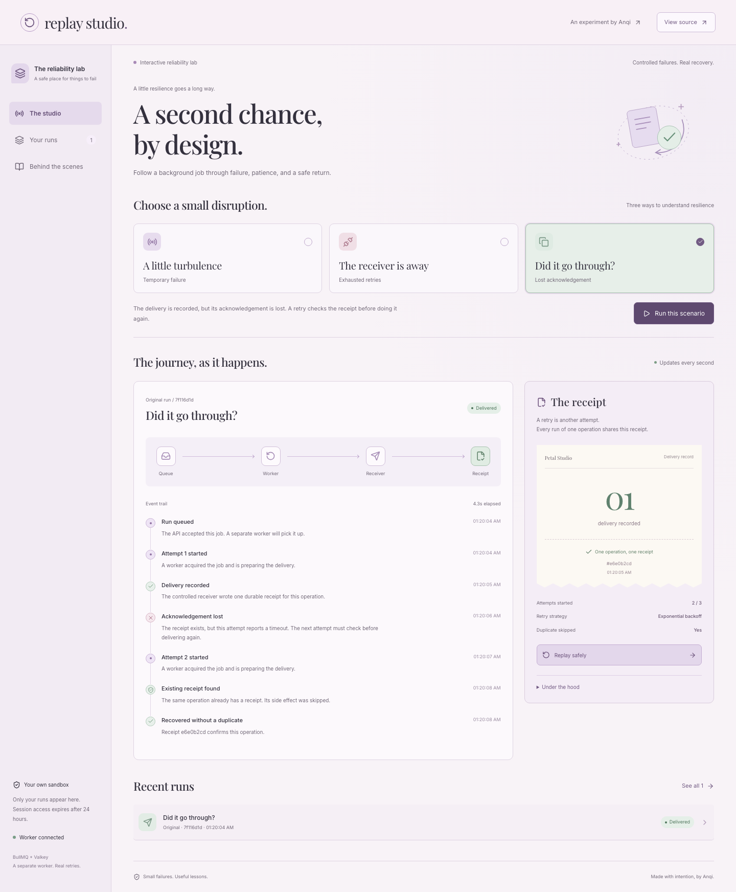
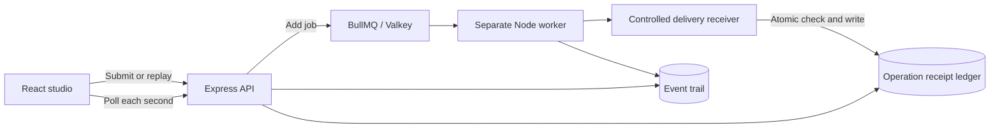

# Replay Studio

**A second chance, by design.**

An interactive reliability lab by [Anqi Chen](https://onlyanqi.github.io/portfolio/). Submit a background job, introduce a controlled failure, and follow real worker events through retry, recovery, and duplicate prevention.

This is the third project in a series about thoughtful interfaces and dependable systems, following [Moodboard Radio](https://github.com/onlyanqi/moodboard-radio) and [Access Studio](https://github.com/onlyanqi/access-studio).



## What makes it a systems project

The timeline is a view of actual server events. BullMQ holds jobs in Valkey; a separate Node worker runs them. Closing the page does not cancel a job. A worker can stop while a job waits, then resume processing when restarted.

The receiver is deliberately controlled: it writes a receipt to Valkey rather than sending a real email, webhook, or payment. This gives visitors a safe way to understand failure without third-party credentials or accidental external effects.

| Scenario             | What happens                                                  | What it teaches                                 |
| -------------------- | ------------------------------------------------------------- | ----------------------------------------------- |
| A little turbulence  | Two 503 responses, then success on attempt three              | Bounded retries and exponential backoff         |
| The receiver is away | Three failures, then manual replay with the receiver restored | Terminal failure, diagnosis, recovery lineage   |
| Did it go through?   | A receipt is committed, then the acknowledgement is lost      | At-least-once processing and idempotent effects |

Manual replay creates a new run with the **same operation key** and a link to its parent. It never rewrites the first run’s history. The receiver atomically checks and writes receipts, so concurrent attempts within the retention window return one receipt.

## Run locally

Requires Node.js 22.13+ and a Redis-compatible server (tested with Valkey 9.1.2).

```sh
npm ci
cp .env.example .env
mkdir -p .data
# Terminal 1: an isolated store on port 6380; leave running
valkey-server --bind 127.0.0.1 --port 6380 --dir .data \
  --appendonly yes --appendfsync everysec --maxmemory-policy noeviction
# Terminal 2: API, separate worker, and Vite frontend
npm run dev
```

Visit **http://localhost:3001**. Access Studio can continue using port 3000.

On macOS, install Valkey with `brew install valkey`. Alternatively, use `docker compose up --build` for the complete app and store.

```sh
npm run typecheck
npm test                      # Unit + real queue integration tests; needs Valkey
npx playwright install chromium
npm run test:e2e               # Needs the local dev services above
npm run build
```

Queue integration tests use a unique key prefix, create real workers, and clean up only their own namespace. They do not flush the store. Browser tests use isolated visitor sessions.

## Stack and reuse

- React, TypeScript, Vite: interface and browser build.
- Express: session-scoped API.
- [BullMQ](https://github.com/taskforcesh/bullmq) (MIT): queue state, attempts, delayed retries, worker locks, and failed-job retention.
- [Valkey](https://github.com/valkey-io/valkey) (BSD-3-Clause): durable queue storage, event trails, atomic receipt ledger.
- Lucide (ISC): icons. Playfair Display and Inter (SIL OFL): typography.

Original work: controlled receiver scenarios, replay lineage, visitor isolation, receipt semantics, visual explanations, integration tests, and pastel product design. This project does not implement a queue engine from scratch.

## Architecture



See [reliability model](docs/reliability.md), [design](docs/design.md), and [deployment](docs/deployment.md).

## Honest boundaries

This is a local, working MVP, not a hosted production service. It does not claim universal exactly-once delivery. The receiver’s single-receipt guarantee is specific to an atomic Valkey operation and the receipt’s retention window. Calling a third-party API safely would require that receiver to support an idempotency key or another reconciliation design.

Each visitor receives an opaque HttpOnly session cookie. Session access expires after 24 hours, and sessions are limited to 30 runs. Receipt and event keys expire; BullMQ age-based cleanup is lazy and happens during subsequent finalization. This is not permanent audit storage. Failed runs remain in BullMQ’s failed set; no separate dead-letter queue is implemented.

The application has no accounts, customer data, public webhook destinations, or outbound messages. Public deployment still needs hosting, operational quotas, and retention monitoring. Store persistence uses AOF every-second fsync for this lab; a sudden host failure can lose the most recent writes. Multi-region durability is outside this version.
